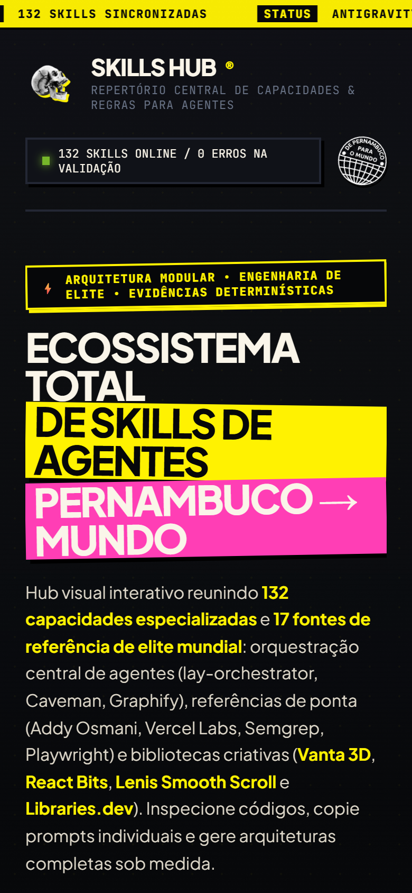
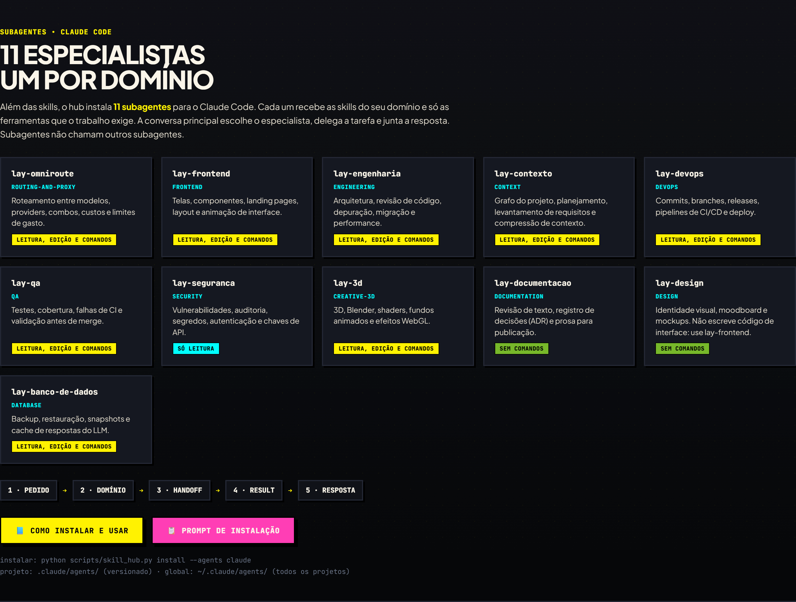
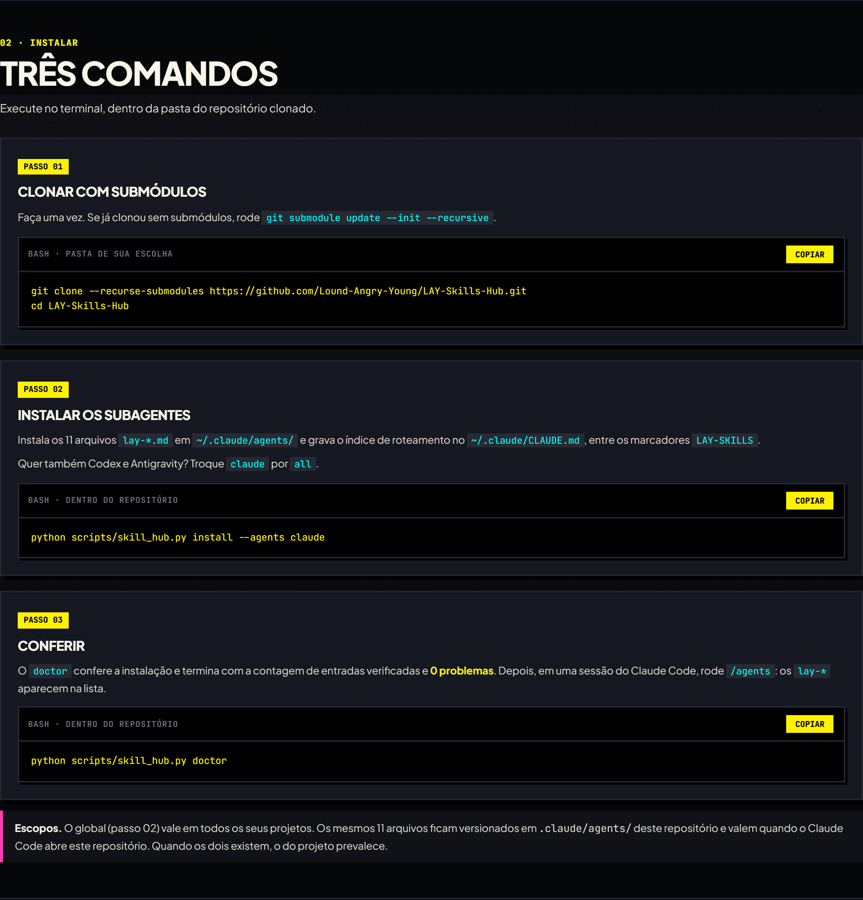
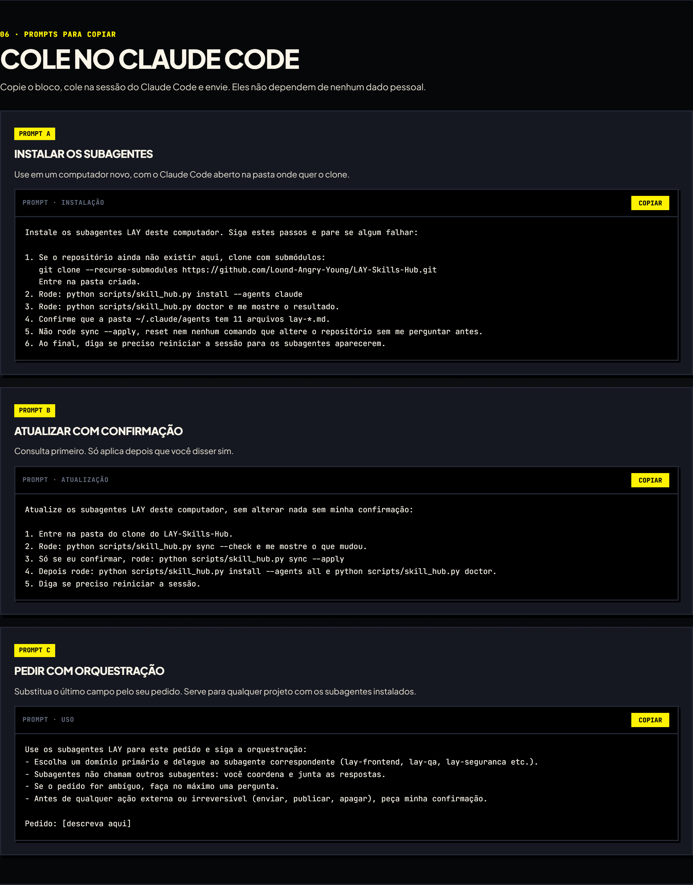

<div align="center">

# ⚡ LAY Skills Hub

**Base de habilidades, subagentes e regras para agentes de IA**

Google Antigravity · OpenAI Codex · Claude Code


<br>

<a href="https://lound-angry-young.github.io/LAY-Skills-Hub/">
  
</a>

<br><br>

[**🌐 Dashboard**](https://lound-angry-young.github.io/LAY-Skills-Hub/) &nbsp;·&nbsp;
[**📘 Guia dos subagentes**](https://lound-angry-young.github.io/LAY-Skills-Hub/instalacao.html) &nbsp;·&nbsp;
[**⬇️ Instalação**](#-instalação) &nbsp;·&nbsp;
[**🤖 Subagentes**](#-subagentes-para-claude-code)

</div>

---

## 📑 Sumário

- [Visão geral](#-visão-geral)
- [Galeria](#-galeria)
- [Subagentes para Claude Code](#-subagentes-para-claude-code)
- [Adicionar skills](#-adicionar-skills)
- [Instalação](#-instalação)
- [Taxonomia das 132 habilidades](#-taxonomia-das-132-habilidades)
- [Publicação no GitHub Pages](#-publicação-no-github-pages)
- [Mídia](#-mídia)

---

## 🎯 Visão geral

O **LAY Skills Hub** abastece assistentes de código e agentes autônomos (**Google Antigravity**, **OpenAI Codex** e **Claude Code**) com **132 habilidades** e diretrizes técnicas, além de **11 subagentes** especialistas para o Claude Code.

Em vez de respostas genéricas, o hub injeta na camada de contexto dos agentes contratos de arquitetura, metodologia de testes (TDD), regras de segurança (OWASP Top 10) e bibliotecas criativas contemporâneas.

| | |
| :--- | :--- |
| 🧠 **132 skills homologadas** | Curadoria de práticas da indústria: Addy Osmani, Vercel Labs, Semgrep e Microsoft Playwright. |
| 🤖 **11 subagentes** | Um especialista por domínio para o Claude Code, instalado globalmente ou versionado no projeto. |
| 🎛️ **Dashboard visual** | Interface estática (`index.html`), pronta para uso local ou no GitHub Pages. |
| 🧾 **Prompts sob medida** | Monte uma seleção de skills e copie o plano de projeto formatado com um clique. |
| 🧭 **Contexto e grafos** | Diagnóstico inicial com `lay-orchestrator`, grafos com **Graphify** e comunicação concisa com **Caveman**. |
| 🎬 **Stack criativa** | Suporte a **Vanta 3D**, **React Bits**, **Lenis Smooth Scroll** e **Libraries.dev**. |

---

## 🖼️ Galeria

<table>
  <tr>
    <td align="center" width="50%">
      <br>
      <sub><b>Dashboard</b>: hero, métricas e atalhos do hub</sub>
    </td>
    <td align="center" width="50%">
      <br>
      <sub><b>Catálogo</b>: busca, filtros por categoria e cards com ações</sub>
    </td>
  </tr>
  <tr>
    <td align="center" width="50%">
      <br>
      <sub><b>Especificação</b>: o <code>SKILL.md</code> completo, com a fonte</sub>
    </td>
    <td align="center" width="50%">
      <br>
      <sub><b>Prompt mestre</b>: inicialização pronta para qualquer projeto novo</sub>
    </td>
  </tr>
  <tr>
    <td align="center" width="50%">
      <br>
      <sub><b>Planejador</b>: só as skills selecionadas entram no prompt</sub>
    </td>
    <td align="center" width="50%">
      <br>
      <sub><b>Celular</b>: o dashboard funciona sem rolagem horizontal</sub>
    </td>
  </tr>
</table>

### 🤖 Subagentes e guia de instalação

<table>
  <tr>
    <td align="center" colspan="2">
      <br>
      <sub><b>Os 11 subagentes</b>: um por domínio, com as ferramentas de cada um</sub>
    </td>
  </tr>
  <tr>
    <td align="center" width="50%">
      <br>
      <sub><b>Guia de instalação</b>: clonar, instalar e conferir</sub>
    </td>
    <td align="center" width="50%">
      <br>
      <sub><b>Prompts prontos</b>: instalar, atualizar com confirmação e pedir com orquestração</sub>
    </td>
  </tr>
</table>

---

## 🤖 Subagentes para Claude Code

O hub traz **11 subagentes** para o Claude Code, um especialista por domínio. Cada um recebe as skills do seu domínio e só as ferramentas que o trabalho exige. A conversa principal escolhe o especialista, delega a tarefa e junta a resposta. **Subagentes não chamam outros subagentes.**

| Subagente | Domínio | Use quando | Ferramentas |
| :--- | :--- | :--- | :--- |
| `lay-omniroute` | routing-and-proxy | roteamento entre modelos, providers, combos, custos e limites de gasto | leitura, edição e comandos |
| `lay-frontend` | frontend | telas, componentes, landing pages, layout e animação | leitura, edição e comandos |
| `lay-engenharia` | engineering | arquitetura, revisão de código, depuração, migração e performance | leitura, edição e comandos |
| `lay-contexto` | context | grafo do projeto, planejamento, requisitos e compressão de contexto | leitura, edição e comandos |
| `lay-devops` | devops | commits, branches, releases, CI/CD e deploy | leitura, edição e comandos |
| `lay-qa` | qa | testes, cobertura, falhas de CI e validação antes de merge | leitura, edição e comandos |
| `lay-seguranca` | security | vulnerabilidades, auditoria, segredos e autenticação | só leitura (não edita arquivos) |
| `lay-3d` | creative-3d | 3D, Blender, shaders, fundos animados e WebGL | leitura, edição e comandos |
| `lay-documentacao` | documentation | revisão de texto, ADRs e prosa para publicação | sem comandos (sem Bash) |
| `lay-design` | design | identidade visual, moodboard e mockups (não escreve código de interface) | sem comandos (sem Bash) |
| `lay-banco-de-dados` | database | backup, restauração, snapshots e cache de respostas | leitura, edição e comandos |

### Como chamar

- **Automático:** escreva o pedido normalmente. O Claude escolhe o subagente pela `description`, que traz os gatilhos "Use quando" e "Não use para".
- **Pelo nome:** `use o subagente lay-qa para cobrir o checkout com testes`.
- Subagente novo não aparece? Reinicie a sessão: os perfis são carregados no início.

### Onde ficam

- **Global**, em `~/.claude/agents/`: vale em todos os seus projetos.
- **Projeto**, em [`.claude/agents/`](.claude/agents/): versionado neste repositório. Quando os dois existem, o do projeto prevalece.

### Orquestração

As regras de roteamento estão na seção "Orquestração de subagentes" do [`CLAUDE.md`](CLAUDE.md). O contrato de handoff está em [`agents/wiring/HANDOFF.md`](agents/wiring/HANDOFF.md) e o índice em [`agents/README.md`](agents/README.md).

📘 **Guia completo, com prompts para copiar:** [instalação e uso dos subagentes](https://lound-angry-young.github.io/LAY-Skills-Hub/instalacao.html).

---

## ➕ Adicionar skills

Uma skill ou um lote inteiro entra no padrão com um comando. O gerador confere o formato, atualiza os roteadores do domínio e regenera catálogo, dashboard e subagentes. Se algo estiver fora do padrão, nada é gravado.

```bash
python scripts/nova_skill.py dominios                      # domínios, skills e subagente de cada um
python scripts/nova_skill.py nova <nome> --dominio <dominio> --descricao "<texto>" --corpo corpo.md
python scripts/nova_skill.py lote <pasta>                  # pasta <dominio>/<nome>/SKILL.md, tudo ou nada
python scripts/nova_skill.py regenerar
```

📘 Passo a passo, formato e skills privadas: [docs/ADICIONAR_SKILLS.md](docs/ADICIONAR_SKILLS.md).

---

## ⬇️ Instalação

<details open>
<summary><b>Opção 1: dashboard local, sem instalar nada</b></summary>

Dê um duplo clique em [`index.html`](index.html), ou rode no PowerShell:

```powershell
Start-Process "index.html"
```

</details>

<details open>
<summary><b>Opção 2: clonar com as fontes (submódulos)</b></summary>

```bash
git clone --recurse-submodules https://github.com/Lound-Angry-Young/LAY-Skills-Hub.git
cd LAY-Skills-Hub
```

Já clonou sem submódulos? Rode `git submodule update --init --recursive`.

</details>

<details open>
<summary><b>Opção 3: instalar nos agentes</b></summary>

Distribui as skills para os perfis globais do **Google Antigravity**, **OpenAI Codex** e **Claude Code**, incluindo os 11 subagentes.

| Sistema | Comando |
| :--- | :--- |
| Windows (PowerShell) | `powershell -ExecutionPolicy Bypass -File ".\install.ps1"` |
| Linux / macOS | `bash "./install.sh"` |
| Só Claude Code | `python scripts/skill_hub.py install --agents claude` |
| Conferir a instalação | `python scripts/skill_hub.py doctor` |

Atualizar e remover:

```bash
python scripts/skill_hub.py sync --check     # consulta as fontes, não altera nada
python scripts/skill_hub.py sync --apply     # aplica atualizações (explícito)
python scripts/skill_hub.py install --agents all
python scripts/skill_hub.py uninstall
```

<details>
<summary>Regra de atualização das fontes</summary>

1. **Consulta:** automática no início de sessão, por projeto. Não altera nenhum arquivo.
2. **Aplicação:** explícita, com `sync --apply`. Só fast-forward limpo; alterações locais são preservadas.
3. **Commit:** cada fonte atualizada vira um commit `chore(upstream): atualizar <fonte> para <sha7>`.
4. **Reflexo nos agentes:** depois, `install --agents all`.

</details>

</details>

---

## 🏛️ Taxonomia das 132 Habilidades

| Domínio | Fontes & Destaques | Capacidades Chave |
| :--- | :--- | :--- |
| **Engenharia & Arquitetura** | Addy Osmani (`agent-skills`), Vercel Labs | TDD rigoroso, interfaces estáveis, simplificação de código, refatoração segura, composition patterns. |
| **Segurança & Auditoria** | Semgrep (`skills`), Ray0907 (`security-scan`) | Análise estática (SAST), regras OWASP Top 10, proteção contra prompt injection em LLMs (OWASP Top 10 for LLM 2025). |
| **Interface & Design** | Vercel Labs, Leon Lin (`taste-skill`), Voltagent | Diretrizes de acessibilidade WCAG AA, design systems de referência, transições nativas (`ViewTransition`), microinterações. |
| **Criatividade & 3D WebGL** | Darkroom Engineering, Tengbao, DavidHDev, Jakub Antalik | Rolagem inercial (**Lenis**), fundos 3D reativos (**Vanta.js**), componentes animados (**React Bits**), catálogo **Libraries.dev**. |
| **Qualidade & E2E** | Microsoft Playwright CLI, Dietrich Gebert (`ponytail`) | Automação e inspeção de navegadores reais via CLI, auditoria de código redundante (YAGNI). |
| **Contexto & Orquestração** | `lay-orchestrator`, Julius Brussee (`caveman`), Safi Shamsi (`graphify`) | Diagnóstico inicial de projetos, grafos persistentes de arquitetura, modo conciso de comunicação direta. |

---

## 🌐 Publicação no GitHub Pages

O repositório já está pronto para o **GitHub Pages**: há o arquivo [`.nojekyll`](.nojekyll) na raiz e o workflow [`.github/workflows/deploy-pages.yml`](.github/workflows/deploy-pages.yml).

<details>
<summary>Como ativar em um fork ou repositório seu</summary>

1. Acesse **Settings** > **Pages** no GitHub.
2. Em **Build and deployment**, selecione **GitHub Actions** (ou **Deploy from a branch** > `main` / `/ (root)`).
3. O dashboard ficará em `https://<seu-usuario>.github.io/<seu-repositorio>/`.

</details>

---

## 📂 Mídia

Capturas usadas neste README, em `docs/assets/screenshots/`:

| Arquivo | Conteúdo |
| :--- | :--- |
| [`01-hub-overview.png`](docs/assets/screenshots/01-hub-overview.png) | Hero do dashboard com métricas (1440x960 @ 2x) |
| [`02-skills-catalog.png`](docs/assets/screenshots/02-skills-catalog.png) | Catálogo com filtros e cards |
| [`03-subagentes.png`](docs/assets/screenshots/03-subagentes.png) | Seção dos 11 subagentes |
| [`04-skill-detail-modal.png`](docs/assets/screenshots/04-skill-detail-modal.png) | Modal de especificação de skill |
| [`05-master-prompt.png`](docs/assets/screenshots/05-master-prompt.png) | Modal do prompt mestre |
| [`06-custom-prompt-planner.png`](docs/assets/screenshots/06-custom-prompt-planner.png) | Planejador sob medida |
| [`07-social-linkedin-card.png`](docs/assets/screenshots/07-social-linkedin-card.png) | Card para redes sociais (1200x630 @ 2x) |
| [`08-guia-instalacao.png`](docs/assets/screenshots/08-guia-instalacao.png) | Guia de instalação |
| [`09-guia-prompts.png`](docs/assets/screenshots/09-guia-prompts.png) | Prompts prontos para copiar |
| [`10-mobile-hub.png`](docs/assets/screenshots/10-mobile-hub.png) | Dashboard no celular (390x844 @ 2x) |

---

<div align="center">

Desenvolvido para máxima performance e autonomia de agentes de IA • Padrão de Engenharia de Elite

</div>
