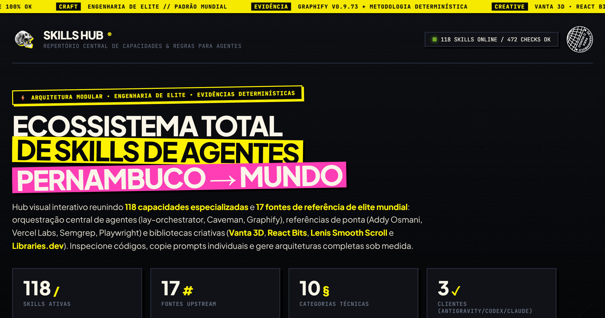
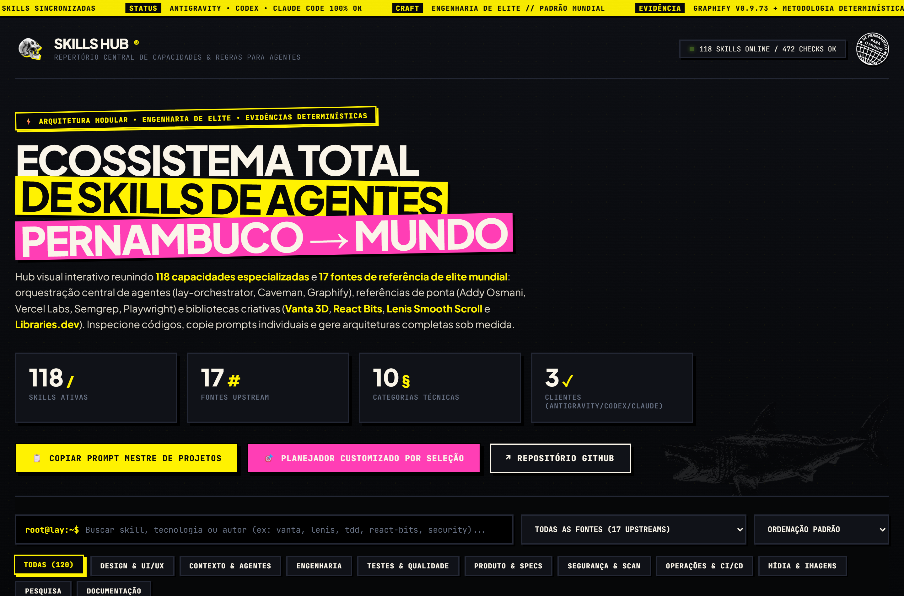
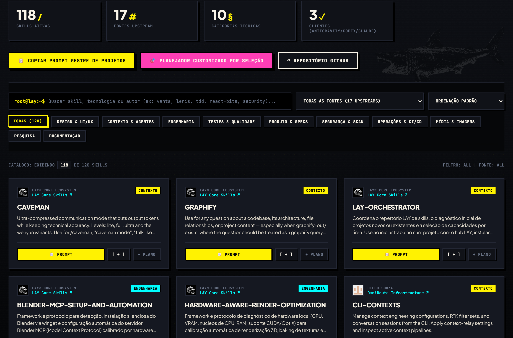
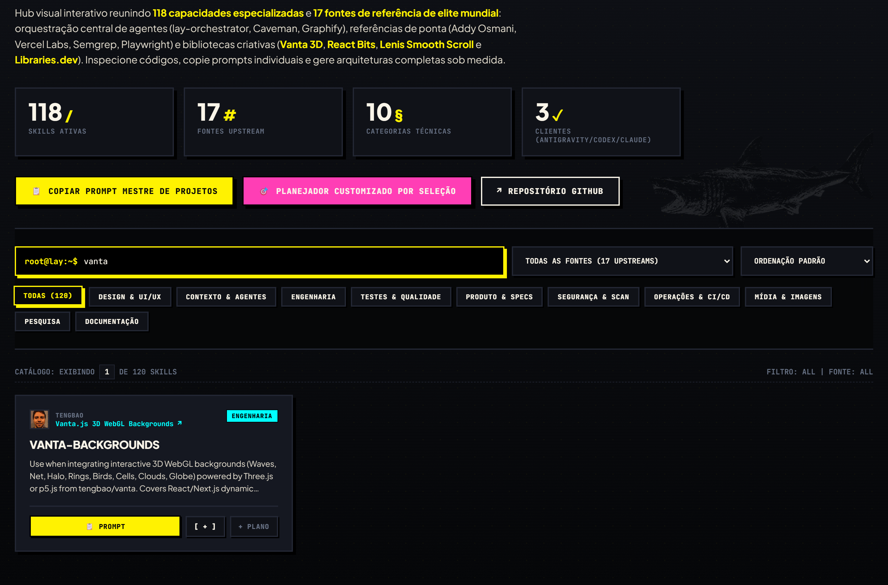
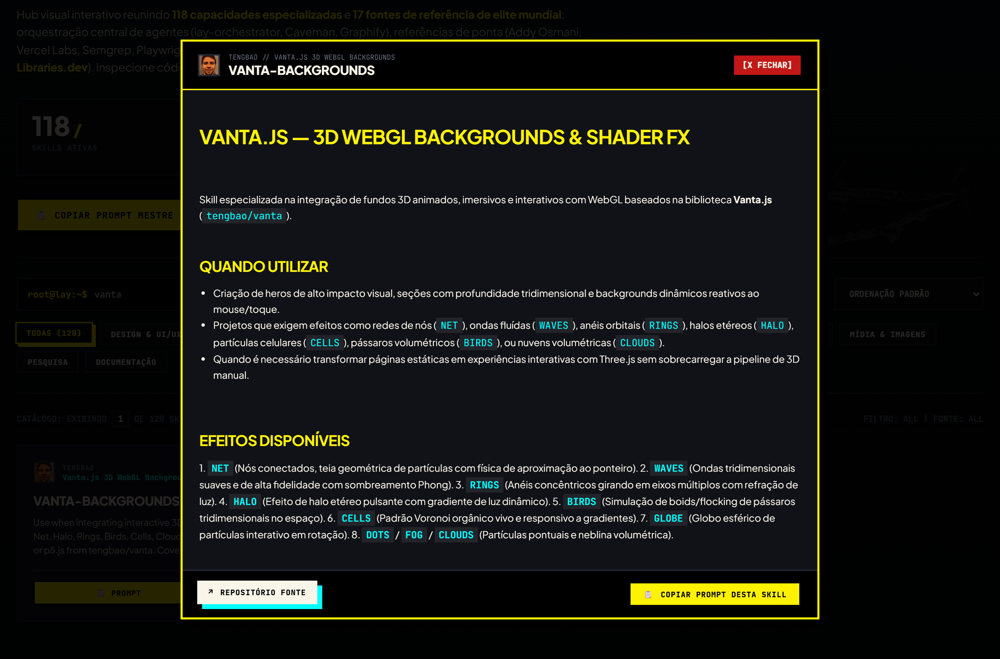
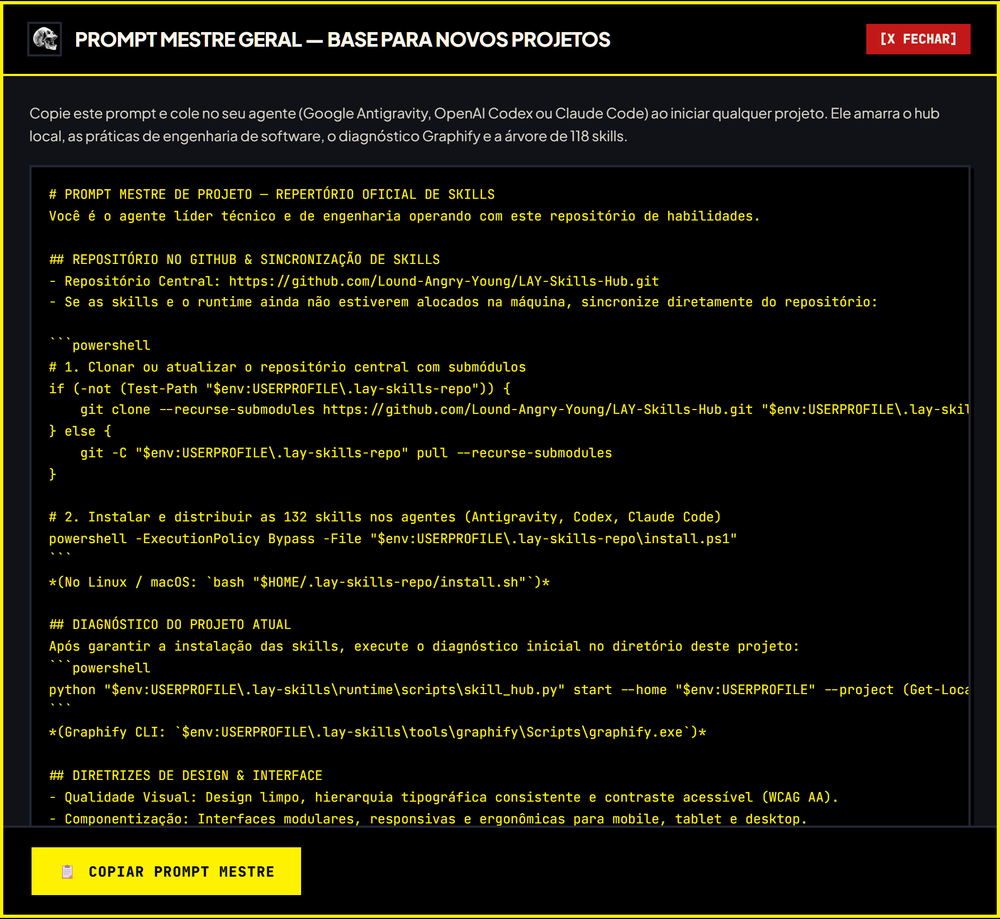
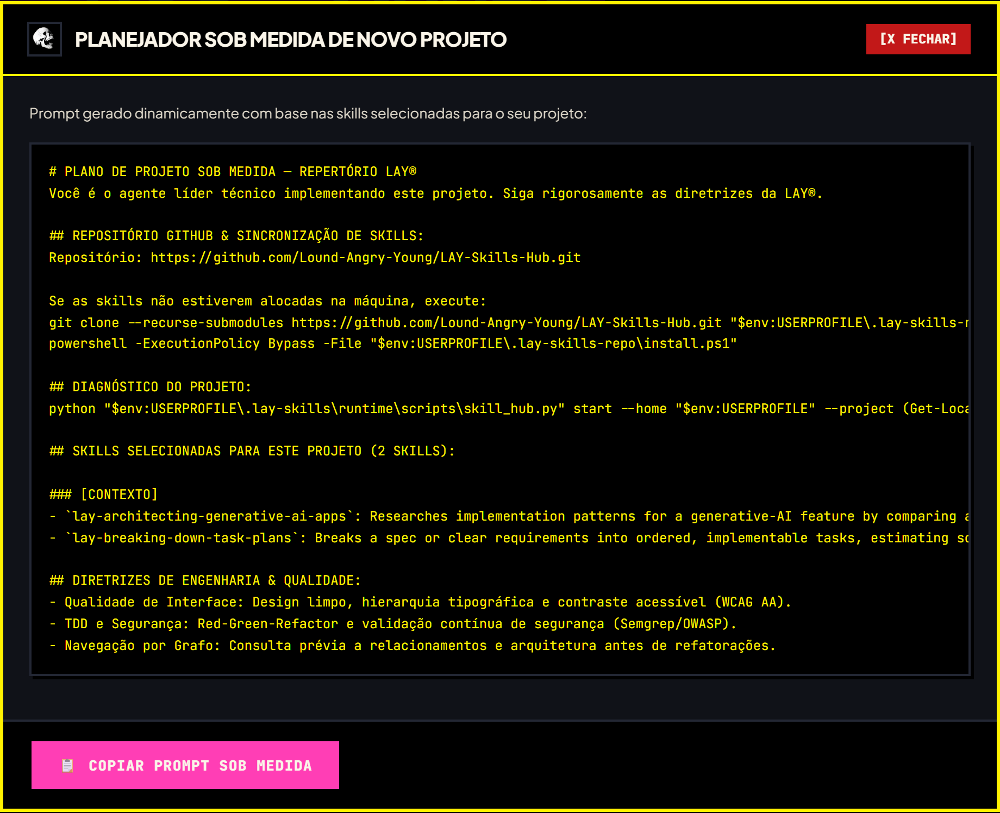

# ⚡ LAY Skills Hub — Base de Habilidades para Agentes de IA

<div align="center">


<br>

**Repositório central de engenharia de software, orquestração de contexto, TDD e capacidades criativas para agentes de Inteligência Artificial.**

<br>



</div>

---

## 🎯 Visão Geral

O **LAY Skills Hub** é uma plataforma e infraestrutura modular projetada para abastecer assistentes de código e agentes autônomos (**Google Antigravity**, **OpenAI Codex**, **Claude Code**) com mais de **132 habilidades e diretrizes técnicas comprovadas**.

Em vez de depender de heurísticas rasas ou respostas genéricas de LLM, o hub injeta contratos rigorosos de arquitetura, metodologias de teste (TDD), regras de segurança (OWASP Top 10) e bibliotecas criativas contemporâneas diretamente na camada de contexto dos agentes.

### 🌟 Destaques Principais:
- **132 Skills Homologadas:** Curadoria das melhores práticas da indústria (Addy Osmani, Vercel Labs, Semgrep, Microsoft Playwright).
- **Dashboard Visual Web:** Interface estática independente (`index.html`) pronta para uso local ou publicação instantânea via **GitHub Pages**.
- **Gerador de Prompts sob Medida:** Componha seleções específicas de habilidades e copie instruções formatadas com um clique.
- **Orquestração Inteligente:** Integração nativa com navegação em grafos (**Graphify**) e comunicação ultra-concisa (**Caveman**).
- **Stack Criativa & 3D WebGL:** Suporte arquitetural a **Vanta 3D**, **React Bits**, **Lenis Smooth Scroll** e **Libraries.dev**.

---

## 📸 Demonstração Visual & Galeria para Redes Sociais

> **💡 Dica para Redes Sociais:** Todas as capturas abaixo estão disponíveis em alta resolução (resolução Retina 2x) no diretório [`docs/assets/screenshots/`](docs/assets/screenshots/) e formatadas para compartilhamento no **LinkedIn**, **Twitter/X** e apresentações executivas.

<div align="center">

### 1. Visão Geral do Hub & Telemetria

*Interface principal com contador em tempo real, telemetria de runtimes e status de integração.*

<br>

### 2. Catálogo Completo & Grade de Filtros

*Exploração por categorias: Engenharia, Contexto, Testes, Segurança, Design e Operações.*

<br>

### 3. Stack Criativa (3D WebGL, Cinemática & Shaders)

*Módulos especializados em microinterações, física de scroll e backgrounds interativos Three.js.*

<br>

### 4. Inspeção de Especificação (Modal SKILL.md)

*Visualização inline das instruções completas, comandos de execução e metadados de proveniência.*

<br>

### 5. Prompt Mestre Universal para Novos Projetos

*Script de inicialização pronto para orquestrar agentes em qualquer novo repositório.*

<br>

### 6. Planejador Sob Medida por Seleção Ativa

*Geração dinâmica de prompts injetando exclusivamente as habilidades selecionadas na sessão.*

</div>

---

## 🚀 Como Executar

### 1. Acesso Imediato ao Dashboard Web
A interface visual não requer servidor Node.js ou dependências complexas:
- **Via Navegador:** Dê um duplo clique no arquivo [`index.html`](index.html) na raiz do repositório.
- **Via Terminal (PowerShell):**
  ```powershell
  Start-Process "index.html"
  ```

### 2. Clonagem com Submódulos Upstream
Para clonar este hub com todas as fontes e bibliotecas integradas:
```bash
git clone --recurse-submodules https://github.com/Lound-Angry-Young/SKILLS-E-CONFIGS-PARA-NOVOS-PROJETOS.git
```

### 3. Instalação nos Agentes Locais
Para distribuir automaticamente as skills nos perfis globais do **Google Antigravity**, **OpenAI Codex** ou **Claude Code**:

- **Windows (PowerShell):**
  ```powershell
  powershell -ExecutionPolicy Bypass -File ".\install.ps1"
  ```
- **Linux / macOS (Bash):**
  ```bash
  bash "./install.sh"
  ```

---

## 🏛️ Taxonomia das 132 Habilidades

| Domínio | Fontes & Destaques | Capacidades Chave |
| :--- | :--- | :--- |
| **Engenharia & Arquitetura** | Addy Osmani (`agent-skills`), Vercel Labs | TDD rigoroso, interfaces estáveis, simplificação de código, refatoração segura, composition patterns. |
| **Segurança & Auditoria** | Semgrep (`skills`), Ray0907 (`security-scan`) | Análise estática (SAST), regras OWASP Top 10, proteção contra prompt injection em LLMs (OWASP Top 10 for LLM 2025). |
| **Interface & Design** | Vercel Labs, Leon Lin (`taste-skill`), Voltagent | Diretrizes de acessibilidade WCAG AA, design systems de referência, transições nativas (`ViewTransition`), microinterações. |
| **Criatividade & 3D WebGL** | Darkroom Engineering, Tengbao, DavidHDev, Jakub Antalik | Rolagem inercial (**Lenis**), fundos 3D reativos (**Vanta.js**), componentes animados (**React Bits**), catálogo **Libraries.dev**. |
| **Qualidade & E2E** | Microsoft Playwright CLI, Dietrich Gebert (`ponytail`) | Automação e inspeção de navegadores reais via CLI, auditoria de código redundante (YAGNI). |
| **Contexto & Orquestração** | `lay-orchestrator`, Julius Brussee (`caveman`), Safi Shamsi (`graphify`) | Diagnóstico inicial de projetos, grafos persistentes de arquitetura, modo conciso de comunicação direta. |

---

## 🌐 Publicação no GitHub Pages

Este repositório já está 100% configurado para rodar no **GitHub Pages**:

1. Arquivo de bypass do Jekyll [`.nojekyll`](.nojekyll) presente na raiz.
2. Workflow de automação [`.github/workflows/deploy-pages.yml`](.github/workflows/deploy-pages.yml) pré-configurado.
3. Para ativar em seu fork ou repositório:
   - Acesse **Settings** > **Pages** no GitHub.
   - Em **Build and deployment**, selecione **GitHub Actions** (ou **Deploy from a branch** > `main` / `/ (root)`).
   - O dashboard estará acessível em: `https://<seu-usuario>.github.io/<seu-repositorio>/`.

---

## 📂 Recursos de Mídia para Download

Os ativos visuais preparados para divulgação externa encontram-se em:
- [`docs/assets/screenshots/01-hub-overview.png`](docs/assets/screenshots/01-hub-overview.png) — *Visão panorâmica do Hub (1440x950 @ 2x)*
- [`docs/assets/screenshots/02-skills-catalog.png`](docs/assets/screenshots/02-skills-catalog.png) — *Grid do catálogo de capacidades*
- [`docs/assets/screenshots/03-new-creative-skills.png`](docs/assets/screenshots/03-new-creative-skills.png) — *Módulos criativos e animações*
- [`docs/assets/screenshots/04-skill-detail-modal.png`](docs/assets/screenshots/04-skill-detail-modal.png) — *Modal de especificação técnica*
- [`docs/assets/screenshots/05-master-prompt.png`](docs/assets/screenshots/05-master-prompt.png) — *Modal do prompt mestre*
- [`docs/assets/screenshots/06-custom-prompt-planner.png`](docs/assets/screenshots/06-custom-prompt-planner.png) — *Modal do planejador personalizado*
- [`docs/assets/screenshots/07-social-linkedin-card.png`](docs/assets/screenshots/07-social-linkedin-card.png) — *Card oficial para LinkedIn (1200x630 @ 2x)*

---

<div align="center">

Desenvolvido para máxima performance e autonomia de agentes de IA • Padrão de Engenharia de Elite

</div>
