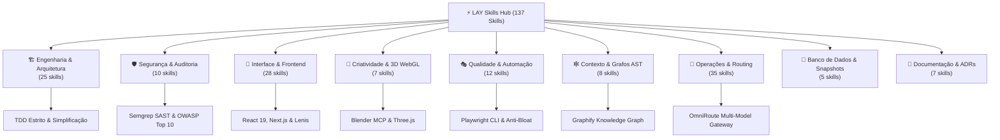

<div align="center">

# ⚡ LAY Skills Hub

**Base Universal de Habilidades de Engenharia, Subagentes Especialistas e Governança para Agentes de IA**

*Google Antigravity · OpenAI Codex · Claude Code*


<br>


<br><br>

[**🌐 Dashboard**](index.html) &nbsp;·&nbsp;
[**📘 Guia dos Subagentes**](instalacao.html) &nbsp;·&nbsp;
[**⬇️ Instalação Rápida**](#️-instalação-no-computador-e-agentes) &nbsp;·&nbsp;
[**🤖 Subagentes**](#-subagentes-especialistas) &nbsp;·&nbsp;
[**🏛️ Taxonomia das Skills**](#️-taxonomia-e-domínios-técnicos) &nbsp;·&nbsp;
[**👑 Créditos**](#-autoria-e-créditos)

</div>

---

## 📑 Sumário

- [Visão Geral](#-visão-geral)
- [Galeria de Interface](#-galeria-de-interface)
- [Subagentes Especialistas](#-subagentes-especialistas)
- [Taxonomia e Domínios Técnicos](#️-taxonomia-e-domínios-técnicos)
- [Padrão de Engenharia de Elite (PADRAO_DE_SKILLS)](#-padrão-de-engenharia-de-elite)
- [Componentes Animados de Referência](#-componentes-animados-de-referência)
- [Instalação no Computador e Agentes](#️-instalação-no-computador-e-agentes)
- [Gestão e Criação de Novas Skills](#-gestão-e-criação-de-novas-skills)
- [Autoria e Créditos](#-autoria-e-créditos)

---

## 🎯 Visão Geral

O **LAY Skills Hub** é um ecossistema de alto nível projetado para abastecer assistentes de código e agentes autônomos (**Google Antigravity**, **OpenAI Codex** e **Claude Code**) com **137 habilidades rigorosamente homologadas**, diretrizes contratuais de arquitetura e **11 subagentes especializados**.

Em vez de respostas genéricas e alucinações de código, o hub estabelece um protocolo disciplinado de engenharia:
- **Contratos Arquiteturais Estritos:** Cada tarefa segue assinaturas de entrada/saída (Input/Output Signatures), etapas imperativas com tolerâncias explícitas (`[FRÁGIL]` vs `[FLEXÍVEL]`) e contingências obrigatórias (`On Failure`).
- **Engenharia de Contexto Inteligente:** Redução drástica do consumo de tokens com grafos de conhecimento do repositório (**Graphify AST**) e compressão sintética (**Caveman**).
- **Segurança e Hardening:** Análise estática contínua (SAST) com **Semgrep**, compliance com OWASP Top 10 e blindagem contra vulnerabilidades em agentes de IA (OWASP Top 10 for LLM 2025).
- **Roteamento Resiliente:** Integração nativa com **OmniRoute** para failover entre modelos de IA, caching semântico e limites de orçamento.
- **Stack Criativa & Frontend:** Design systems anti-slop, WCAG AA, microinterações fluidas (GSAP, Lenis Smooth Scroll), Three.js/WebGL (Vanta 3D) e componentes animados curados.

| Recurso | Detalhes Técnicos |
| :--- | :--- |
| 🧠 **137 Skills Homologadas** | Padrão unificado em gerúndio (`action-verb-ing`), responsabilidade única e progressive disclosure. |
| 🤖 **11 Subagentes Especialistas** | Um subagente dedicado por domínio técnico para o Claude Code e Antigravity, operando com permissões de ferramentas mínimas e isoladas. |
| 🎛️ **Dashboard Interativo** | Interface cliente estática local (`index.html`) para consulta, busca inteligente e geração de prompts cirúrgicos. |
| 🛡️ **Segurança em Primeiro Lugar** | Subagentes analíticos (como `lay-seguranca`) operam sem permissão de escrita/modificação destrutiva. |
| 🧭 **Diagnóstico e Grafos** | Inicialização pelo orquestrador `lay-orchestrator`, mapeamento de dependências god-node via AST e comunicação concisa. |

---

## 🖼️ Galeria de Interface

Capturas em alta definição extraídas do ecossistema visual do hub:

<table>
  <tr>
    <td align="center" width="50%">
      <br>
      <sub><b>Dashboard Principal</b>: Visão geral, métricas em tempo real e status operacional</sub>
    </td>
    <td align="center" width="50%">
      <br>
      <sub><b>Catálogo de Skills</b>: Busca instantânea, filtros por domínio e cards com ações diretas</sub>
    </td>
  </tr>
  <tr>
    <td align="center" width="50%">
      <br>
      <sub><b>Especificação Técnica</b>: <code>SKILL.md</code> integral, assinaturas I/O e proveniência</sub>
    </td>
    <td align="center" width="50%">
      <br>
      <sub><b>Prompt Mestre</b>: Template de inicialização rápida para qualquer repositório</sub>
    </td>
  </tr>
  <tr>
    <td align="center" width="50%">
      <br>
      <sub><b>Planejador Sob Medida</b>: Extraia prompts contendo exclusivamente as habilidades necessárias</sub>
    </td>
    <td align="center" width="50%">
      <br>
      <sub><b>Responsividade Total</b>: Visualização perfeita em smartphones sem quebras de layout</sub>
    </td>
  </tr>
  <tr>
    <td align="center" colspan="2">
      <br>
      <sub><b>Matriz de Subagentes</b>: Especialistas por domínio com fronteiras de atuação definidas</sub>
    </td>
  </tr>
  <tr>
    <td align="center" colspan="2">
      <br>
      <sub><b>Guia de Instalação e Handoff</b>: Roteamento simples, delegação segura e contratos de resultado</sub>
    </td>
  </tr>
</table>

---

## 🤖 Subagentes Especialistas

O ecossistema traz **11 subagentes autônomos**, cada um dedicado exclusivamente ao seu domínio de conhecimento. Cada perfil recebe somente o subconjunto de ferramentas que sua especialidade demanda.

> [!IMPORTANT]
> **Hierarquia de Camada Única (Single-Tier):** Subagentes **nunca invocam outros subagentes**. A sessão orquestradora principal recebe o briefing do usuário, delega a tarefa ao especialista adequado e consolida a entrega.

| Subagente | Domínio | Missão & Casos de Uso | Ferramentas Autorizadas |
| :--- | :--- | :--- | :--- |
| `lay-omniroute` | `routing-and-proxy` | Gateway de roteamento de LLMs, compatibilidade OpenAI, combos de resiliência, cálculo de custos por chamada, limites de orçamento, proxies e túneis. | Read, Grep, Glob, Bash, Edit, Write |
| `lay-frontend` | `frontend` | Telas e interfaces em React 19/Next.js, acessibilidade WCAG AA, View Transitions, motion design (GSAP, Lenis), design tokens e anti-slop visual. | Read, Grep, Glob, Bash, Edit, Write |
| `lay-engenharia` | `engineering` | Arquitetura de software, interfaces estáveis, TDD metódico, refatoração segura, code review detalhado, migrações e depuração de causa raiz. | Read, Grep, Glob, Bash, Edit, Write |
| `lay-contexto` | `context` | Mapeamento estrutural por AST e grafos de dependência (**Graphify**), compressão concisa de prompts (**Caveman**), planejamento RTK e economia de tokens. | Read, Grep, Glob, Bash, Edit, Write |
| `lay-devops` | `devops` | Conventional Commits, estratégias de branch/rebase, pipelines de CI/CD, releases semânticas, deploy na Vercel/nuvem e automações de entrega. | Read, Grep, Glob, Bash, Edit, Write |
| `lay-qa` | `qa` | Automação e inspeção de browsers com Playwright CLI, cobertura de testes, validação de pull requests, detecção de código inflado (YAGNI) e benchmarks. | Read, Grep, Glob, Bash, Edit, Write |
| `lay-seguranca` | `security` | Análise estática SAST (**Semgrep**), vulnerabilidades OWASP Top 10, proteção de aplicações com LLM, auditoria de credenciais e compliance. | Read, Grep, Glob, Bash *(Somente Leitura Analítica — Sem Edição)* |
| `lay-3d` | `creative-3d` | Calibração de renderização de hardware (CPU/GPU), automação do Blender headless via MCP, shaders GLSL e backgrounds dinâmicos Three.js. | Read, Grep, Glob, Bash, Edit, Write |
| `lay-documentacao` | `documentation` | Redação de Architecture Decision Records (ADRs), documentação técnica clara, polimento de prosa e higienização de marcas artificiais de IA. | Read, Grep, Glob, Edit, Write *(Sem Execução Bash)* |
| `lay-design` | `design` | Criação de brandkits, identidade visual dark-tech/industrial brutalist, mockups e ponte de geração com o Antigravity CLI com revisão adversária. | Read, Grep, Glob, Bash, Edit, Write |
| `lay-banco-de-dados` | `database` | Integridade e backups de bancos SQLite do OmniRoute, snapshots de segurança, recuperação de tabelas corrompidas e cache de inferência. | Read, Grep, Glob, Bash, Edit, Write |

### Como Invocar os Subagentes

- **Delegação Automática:** No Claude Code ou Antigravity, descreva sua necessidade naturalmente. O agente orquestrador identifica o domínio pelas fronteiras `Use quando:` e `Não use para:` de cada perfil.
- **Delegação Explícita:** Ordene diretamente pelo nome:
  ```text
  "Delegue para o subagente lay-seguranca auditar as rotas de autenticação com Semgrep."
  "Use o subagente lay-frontend para implementar o novo card com scroll inercial do Lenis."
  ```

### Contrato de Resposta (RESULT)
Todo subagente responde rigorosamente com o contrato padronizado:
- `status`: `success` | `failure` | `needs_clarification` | `escalated`
- `artifacts`: caminhos dos arquivos criados ou modificados
- `summary`: síntese objetiva em 2 a 4 frases
- `open_items`: pendências ou próximos passos

---

## 🏛️ Taxonomia e Domínios Técnicos

As **137 habilidades** do ecossistema são categorizadas em domínios técnicos interdependentes:



### Destaques por Categoria

1. **🏗️ Engenharia & Arquitetura (25 skills):**
   - TDD rigoroso (`test-driven-development`), especificação antes do código (`spec-driven-development`), simplificação agressiva (`simplifying-codebase-logic`), interfaces estáveis (`designing-apis-and-interfaces`) e investigação metódica de causas raiz (`debugging-and-error-recovery`).
2. **🛡️ Segurança & Auditoria (10 skills):**
   - Varredura de código estático SAST com Semgrep (`scanning-code-with-semgrep`), mitigação de vulnerabilidades OWASP Top 10 (`auditing-code-security`), proteção contra injeção de prompt e jailbreaks em LLMs (`securing-llm-applications`) e higiene de chaves de API (`managing-api-keys`).
3. **🎨 Interface & Frontend (28 skills):**
   - Composição moderna em React (`architecting-react-composition`), transições de tela nativas (`animating-react-view-transitions`), estética industrial brutalista e dark-tech (`designing-industrial-brutalist-interfaces`) e design systems consistentes (`authoring-stitch-design-systems`).
4. **🌌 Criatividade & 3D WebGL (7 skills):**
   - Instalação e controle headless do Blender via MCP (`configuring-blender-mcp-server`), otimização de renderizadores por perfil de hardware (`calibrating-hardware-rendering`) e fundos 3D reativos com WebGL (`rendering-vanta-backgrounds`).
5. **🎭 Qualidade & Automação E2E (12 skills):**
   - Automação via terminal de navegadores headless com Playwright CLI (`automating-browser-tests`), inspeção e depuração via DevTools (`browser-testing-with-devtools`) e auditoria de abstrações desnecessárias (`auditing-codebase-bloat`).
6. **🕸️ Contexto & Orquestração (8 skills):**
   - Extração do grafo de arquitetura com análise de God Nodes e comunidades de código (`generating-knowledge-graphs`), comunicação direta e sintética sem perda de densidade (`communicating-concisely-with-caveman`) e diagnóstico de partida com `lay-orchestrator`.
7. **🔀 Operações, Roteamento & Gateway (35 skills):**
   - Gateway resiliente OmniRoute para múltiplos providers (`routing-requests-with-omniroute`), compressão de contexto RTK (`compressing-contexts`), gerenciamento de quotas de orçamento (`monitoring-costs-and-usage`) e comunicação Agent-to-Agent (`coordinating-agent-to-agent-sessions`).
8. **💾 Banco de Dados & Snapshots (5 skills):**
   - Resiliência de dados SQLite (`backing-up-omniroute-databases`), restauração de snapshots (`restoring-sqlite-snapshots`) e otimização de cache de respostas de IA.
9. **📝 Documentação & Escrita Técnica (7 skills):**
   - Registro de decisões de arquitetura (`authoring-adrs`), auditoria de estilo técnico (`auditing-writing-guidelines`) e polimento de prosa com remoção de clichês e marcadores de IA (`polishing-user-facing-prose`).

---

## 📐 Padrão de Engenharia de Elite

Toda skill existente ou adicionada ao repositório segue rigorosamente as diretrizes documentadas em [`docs/PADRAO_DE_SKILLS.md`](docs/PADRAO_DE_SKILLS.md):

- **Nome em Gerúndio Canônico (`action-verb-ing`):** Ex.: `simplifying-codebase-logic`, `scanning-code-with-semgrep` (máximo 64 caracteres).
- **Fronteiras Explícitas:** A descrição contém obrigatoriamente cláusulas `Use this skill when:` e `Do NOT use this skill when:`.
- **Responsabilidade Única Absoluta:** Uma ação, um objetivo técnico.
- **Assinatura I/O Formal (`## Input/Output Signature`):**
  - Entradas requeridas e opcionais tipadas.
  - Saídas concretas esperadas (arquivos, diffs, relatórios).
- **Workflow Imperativo com Graus de Liberdade:**
  - `[FRÁGIL]`: Comandos e caminhos que exigem execução literal e exata.
  - `[FLEXÍVEL]`: Etapas onde o agente adapta parâmetros ao contexto da stack.
- **Checklist de Verificação:** Lista copiável de validação final (`- [ ]`).
- **Seção Obrigatória `## On Failure`:** Protocolo explícito de recuperação e fallback caso a execução falhe.
- **Divulgação Progressiva (Progressive Disclosure):** Seções extensas ou scripts de apoio residem em arquivos complementares (`reference.md` e `references/`), evitando poluir a janela de contexto do LLM.

---

## 🧩 Componentes Animados de Referência

O hub inclui catálogo curado com **357 componentes animados** contemporâneos (300 do registro Pixel-Perfect e 57 do Componentry), acessíveis em [`refactored_skills/frontend/selecting-animated-ui-components/reference.md`](refactored_skills/frontend/selecting-animated-ui-components/reference.md).

- **Instalação Sob Demanda:** Nenhum componente pesado é clonado por padrão. Cada componente é baixado sob demanda pela skill `integrating-external-ui-components`.
- **Conformidade Automática:** A skill `verifying-animated-component-compliance` confere renderização em cliente, licença, respeito a `prefers-reduced-motion` e impacto no bundle.

---

## ⬇️ Instalação no Computador e Agentes

A instalação distribui as skills de forma segura e não destrutiva para os perfis globais e locais das ferramentas de IA:

### 1. Requisitos do Sistema
- **Git** instalado no PATH
- **Python 3.10+** (com suporte à biblioteca padrão e venv)
- **Node.js** (opcional, recomendado para ferramentas de frontend/Playwright)

### 2. Clonar o Repositório

\\ash
git clone https://github.com/Lound-Angry-Young/LAY-Skills-Hub.git
cd LAY-Skills-Hub
\
### 3. Comandos de Instalação Automática

| Sistema Operacional | Comando de Instalação |
| :--- | :--- |
| **Windows (PowerShell)** | `powershell -ExecutionPolicy Bypass -File ".\install.ps1"` |
| **Linux / macOS (Bash)** | `bash "./install.sh"` |
| **Todos os Agentes (CLI)** | `python scripts/skill_hub.py install --agents all` |
| **Somente Claude Code** | `python scripts/skill_hub.py install --agents claude` |

### 4. Onde as Skills são Instaladas
- **Google Antigravity IDE / 2.0:** Registrado em `~/.gemini/config/skills` e hook `PreInvocation` em `~/.gemini/GEMINI.md`.
- **Google Antigravity CLI:** Registrado em `~/.gemini/antigravity-cli/skills`.
- **Claude Code:** Registrado em `~/.claude/skills` e subagentes especialistas em `~/.claude/agents/`.
- **OpenAI Codex:** Registrado em `~/.agents/skills` e regras em `~/.codex/AGENTS.md`.
- **Runtime Local Isolado:** Registrado em `~/.lay-skills/runtime/`.

### 5. Diagnóstico e Verificação de Saúde
Após instalar, execute o comando de diagnóstico para conferir integridade de wrappers, subagentes e ferramentas auxiliares:

```bash
python scripts/skill_hub.py doctor
```

---

## ➕ Gestão e Criação de Novas Skills

Adicione uma nova habilidade ao catálogo com validação automática de padrão e regeneração dos índices em um único comando:

```bash
# Listar domínios e seus respectivos subagentes
python scripts/nova_skill.py dominios

# Criar nova skill no padrão estrito
python scripts/nova_skill.py nova <nome-da-skill> --dominio <dominio> --descricao "<texto explicativo>"

# Validar conformidade de todas as skills do catálogo
python scripts/validate_skills.py

# Regenerar catálogo, dashboard e datasets
python scripts/nova_skill.py regenerar
```

📘 Consulte o guia passo a passo completo em [`docs/ADICIONAR_SKILLS.md`](docs/ADICIONAR_SKILLS.md).

---

## 👑 Autoria e Créditos

### Criador e Arquiteto Líder

<div align="center">

### **Georges Ballister**
**Criador, Arquiteto de Sistemas & Mantenedor Líder do LAY Skills Hub**  
*Loud Angry Young (LAY) Ecosystem*  
GitHub: [@GeorgesBallister](https://github.com/GeorgesBallister)

Idealizador da arquitetura do hub, do contrato unificado de skills de elite, da matriz de 11 subagentes especializados por domínio, da taxonomia de 137 habilidades e da interface visual de orquestração.

</div>

---

### Fontes Upstream & Agradecimentos à Comunidade Open-Source

O hub reconhece com respeito o trabalho de excelência desenvolvido pelas comunidades upstream das quais práticas e referências de engenharia foram curadas e refatoradas:

| Repositório Upstream | Autoria / Organização | Contribuição Técnica ao Hub |
| :--- | :--- | :--- |
| [addyosmani/agent-skills](https://github.com/addyosmani/agent-skills) | **Addy Osmani** | Padrões fundamentais de engenharia de software de elite, TDD metódico, depuração sistemática e decomposição de tarefas. |
| [vercel-labs/agent-skills](https://github.com/vercel-labs/agent-skills) | **Vercel Labs** | Diretrizes oficiais de composição em React 19, Next.js, arquitetura de componentes modulares e deploy na Vercel. |
| [semgrep/skills](https://github.com/semgrep/skills) | **Semgrep Team** | Regras de análise estática SAST, diretrizes de segurança de código OWASP Top 10 e blindagem para LLMs. |
| [microsoft/playwright-cli](https://github.com/microsoft/playwright-cli) | **Microsoft** | Automação avançada de navegador via CLI, fluxos de testes E2E e validação visual de interfaces. |
| [diegosouzapw/OmniRoute](https://github.com/diegosouzapw/OmniRoute) | **Diego Souza** | Gateway resiliente de inferência de IA, roteamento de múltiplos modelos, caching semântico e A2A. |
| [safishamsi/graphify](https://github.com/safishamsi/graphify) | **Safi Shamsi** | Motor de grafos de conhecimento de código por AST, detecção de god nodes e clusters de comunidades. |
| [leonxlnx/taste-skill](https://github.com/leonxlnx/taste-skill) | **Leon Lin (@Leonxlnx)** | Estética visual anti-slop, design systems industriais brutalistas, moodboards e imagens para código. |
| [DietrichGebert/ponytail](https://github.com/DietrichGebert/ponytail) | **Dietrich Gebert** | Filosofia de engenharia minimalista anti-bloat, preferência por biblioteca padrão e corte de complexidade acidental. |
| [guillaumemeyer/watermarks-remover](https://github.com/guillaumemeyer/watermarks-remover) | **Guillaume Meyer** | Higienização de metadados, remoção de marcas de proveniência de IA e clareza de prosa para publicação. |
| [Ray0907/security-scan](https://github.com/Ray0907/security-scan) | **Ray Tien (@Ray0907)** | Varredura contínua de vulnerabilidades em dependências, análise de licenças e auditoria CVE. |
| [tengbao/vanta](https://github.com/tengbao/vanta) | **Tengbao** | Biblioteca de fundos interativos 3D animados com WebGL e Three.js. |
| [DavidHDev/react-bits](https://github.com/DavidHDev/react-bits) | **David H. Dev** | Biblioteca contemporânea de animações e microinterações modulares para React. |
| [darkroomengineering/lenis](https://github.com/darkroomengineering/lenis) | **Darkroom Engineering** | Motor inercial de scroll suave de alta precisão independente de FPS. |
| [Jakubantalik/Libraries.dev](https://github.com/Jakubantalik/Libraries.dev) | **Jakub Antalik** | Diretório curado de bibliotecas modernas para desenvolvimento web criativo e shaders. |
| [voltagent/awesome-design-md](https://github.com/voltagent/awesome-design-md) | **VoltAgent** | Especificações de design systems de produtos de classe mundial. |

---

<div align="center">

Desenvolvido para máxima autonomia, precisão técnica e governança de agentes de IA • Padrão de Engenharia LAY®

</div>
