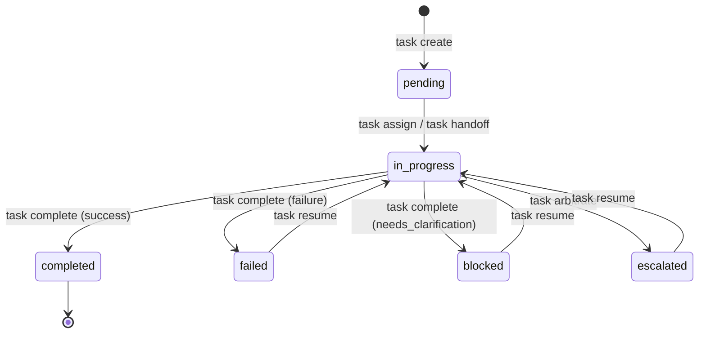
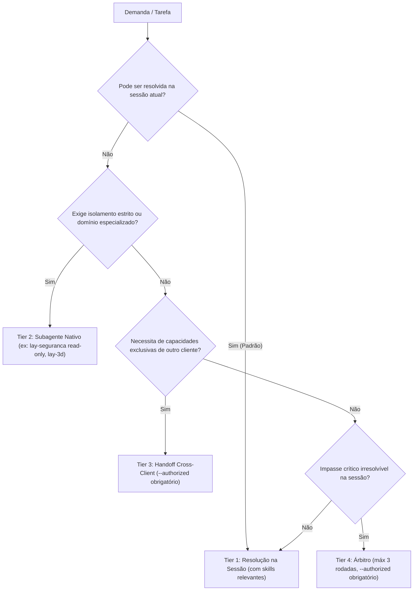

# LAY Orchestrator — Arquitetura, Coordenação e Operação

O **LAY Orchestrator** é o subsistema de coordenação determinística de tarefas do LAY Skills Hub. Ele organiza a colaboração técnica entre desenvolvedores e agentes de IA (**Claude Code** e **Google Antigravity**), priorizando a resolução direta na sessão atual e aplicando delegação mínima justificada.

---

## 1. Princípios Arquiteturais e Modelo de Dados

O Orchestrator adota um modelo assíncrono desacoplado baseado no sistema de arquivos local (`.lay/tasks/task-<id>.json`), sem dependência de serviços em segundo plano, daemons ou file watchers. A criação de arquivos em disco **não** dispara execução automática.

### 1.1 Persistência e Schema Versionado
- **Diretório:** `.lay/tasks/` na raiz do workspace do projeto (ignorado pelo versionamento Git).
- **Identificador de Tarefa:** Expressão regular estrita `^task-[a-z0-9]{8,16}$` (ex: `task-427584d6`), prevenindo path traversal e injeção de nomes de arquivo arbitrários.
- **Validação de Schema:** Todo estado é validado estaticamente contra [`schemas/task.schema.json`](../schemas/task.schema.json) com `schema_version: 1`.
- **Concorrência Segura:** Escritas atômicas protegidas por locks com verificação de PID e timestamp de início de processo (`.lock`), com liberação automática comprovada de processos extintos.

### 1.2 Máquina de Estados Finita e Ciclo de Vida


- **Imutabilidade Terminal:** Tarefas em estado `completed` tornam-se estritamente imutáveis. Qualquer tentativa de alteração de status, reatribuição, reexecução ou novo handoff é prontamente rejeitada com `TaskValidationError`.
- **Recuperação sem Duplicidade:** Tarefas em `failed` ou `blocked` não podem ser concluídas diretamente. Exigem retomada explícita e auditada via `task resume`, limpando o bloco `result` anterior antes de nova tentativa.

---

## 2. Interface de Linha de Comando (CLI)

O gerenciamento de tarefas é exposto via `scripts/skill_hub.py task`:

```bash
# Criar tarefa com classificação heurística automática
python scripts/skill_hub.py task create --workspace <DIR> --title "Refatorar componente Modal" --client antigravity

# Listar tarefas do workspace
python scripts/skill_hub.py task list --workspace <DIR>

# Inspecionar detalhes estruturais de uma tarefa (comando canônico)
python scripts/skill_hub.py task show <ID> --workspace <DIR>

# Consultar recomendação de roteamento (alias: route)
python scripts/skill_hub.py task route --workspace <DIR> --title "Auditoria de segurança estática" --client claude

# Atribuir responsável e modalidade de execução
python scripts/skill_hub.py task assign <ID> --workspace <DIR> --specialist lay-engenharia --mode session

# Transferência de tarefa entre clientes (Cross-Client Handoff)
python scripts/skill_hub.py task handoff <ID> --workspace <DIR> --target-client claude --authorized --reason "Revisão no Claude Code"

# Concluir tarefa com contrato RESULT e validação de artefatos
python scripts/skill_hub.py task complete <ID> --workspace <DIR> --summary "Modal refatorado com sucesso" --artifacts src/Modal.tsx

# Retomar tarefa em falha, bloqueio ou escalonamento
python scripts/skill_hub.py task resume <ID> --workspace <DIR> --reason "Correção das dependências de teste"

# Preparar pacote estruturado para arbitragem crítica
python scripts/skill_hub.py task arbitrate <ID> --workspace <DIR> --problem "Trade-off arquitetural" --alternatives "Opção A" "Opção B"
```

---

## 3. Roteamento Inteligente e Hierarquia de Execução

O roteador opera de forma puramente determinística e local, sem chamadas a LLMs para decidir o encaminhamento. A política segue 4 níveis estritos de precedência:



### Salvaguardas de Perfis Somente-Leitura
- `lay-seguranca`, `lay-banco-de-dados` e `lay-contexto` possuem ferramentas estritamente de leitura.
- Se a tarefa demandar comandos de terminal (`semgrep`, `npm test`) ou migrações ativas de banco (`DROP TABLE`, `ALTER TABLE`), o Orchestrator recusa a atribuição do especialista read-only e mantém a execução na sessão interativa do desenvolvedor.

---

## 4. Contratos Canônicos: HANDOFF e RESULT

Compatibilidade estrita com os contratos canônicos do ecossistema:

### 4.1 Contrato HANDOFF (Transferência)
- `task`: título preciso e objetivo da tarefa.
- `domain`: domínio técnico associado (`frontend`, `engineering`, `security`, etc.).
- `context`: lista mínima de arquivos necessários (evita dumping de sessões inteiras).
- `constraints`: restrições arquiteturais e operacionais.
- `acceptance_criteria`: condições explícitas para validação.

### 4.2 Contrato RESULT (Entrega)
- `status`: `success` | `failure` | `needs_clarification` | `escalated`.
- `summary`: resumo substantivo com no mínimo 3 caracteres.
- `artifacts`: caminhos relativos ao workspace dos arquivos produzidos ou modificados.
- `open_items`: lista de pendências residuais ou decisões em aberto.

#### Validações Físicas de Segurança
- **Existência no Disco:** Todo arquivo declarado em `artifacts` deve existir fisicamente ao registrar a conclusão.
- **Proteção contra Path Traversal:** Tentativas de escape do workspace (ex: `../arquivo.txt` ou caminhos absolutos como `C:/Windows/...`) são interceptadas e causam rejeição imediata da conclusão.

---

## 5. Coordenação Multicliente (Claude Code $\leftrightarrow$ Google Antigravity)

O Orchestrator interliga sessões do **Claude Code** e **Google Antigravity**:
- **Autorização Pontual:** O parâmetro `--authorized` é exigido a cada handoff. A autorização é consumida na operação e **não** permanece ativa como permissão futura permanente.
- **Rastreabilidade Bidirecional:** A cadeia completa de transferências é auditada cronologicamente em `task["history"]`, registrando `source_client`, `target_client`, `timestamp` e `reason`.
- **Tradução Automática de Especialistas:** Ao transferir tarefas em arbitragem, o Orchestrator mapeia automaticamente perfis específicos (`lay-arbitro` no Antigravity $\leftrightarrow$ `lay-arbitro-opus` no Claude Code).
- **Congelamento do Codex:** O cliente `codex` permanece formalmente desabilitado nesta versão, sendo rejeitado com mensagem explicativa em qualquer tentativa de handoff ou roteamento direto.

---

## 6. Limitações Operacionais Explícitas

1. **Ausência de Daemons ou Execução Mágica:** A criação ou handoff de uma tarefa não dispara processos em segundo plano. Cada cliente lê a tarefa sob demanda via CLI ou hook.
2. **Fronteiras de Locks:** Os locks atômicos protegem a concorrência entre comandos CLI locais em disco. A proteção contra reexecução acidental por modelos de IA apoia-se no ciclo de vida e na imutabilidade do status `completed`.
3. **Isolamento de Máquinas:** Não há sincronização de rede ou replicação distribuída entre máquinas distintas nesta fase.
4. **Economia Estrita:** O Orchestrator não realiza chamadas a APIs externas ou modelos durante validações, classificações heurísticas ou handoffs.

---

## 7. Evidências de Validação e Homologação

A confiabilidade do LAY Orchestrator foi atestada em dois níveis claramente diferenciados:

### Nível 1: Suíte Determinística Automatizada (239 Testes — 100% PASS)
- **Execução:** `python -m unittest discover -s tests -p "test_*.py"`
- **Tempo de Execução:** ~23 segundos em ambiente local.
- **Natureza:** Testes unitários e de integração locais, herméticos, executados via biblioteca padrão do Python, sem consumo de cotas de IA, chaves de API ou dependências de rede.
- **Cobertura:** Persistência atômica, recuperação de locks órfãos por verificação de PID, integridade de schema v1, classificação heurística, roteamento por custo, contratos RESULT, proteção traversal, histórico multi-hop e rejeição funcional do Codex.

### Nível 2: Homologação Assistida em Sessões Reais (Fase 3.2 — PASS)
Validação ponta a ponta realizada com modelos e consoles reais em workspace temporário descartável (`C:\Users\georg\AppData\Local\Temp\lay-homologacao-fase3`):

1. **Fluxo Antigravity $\rightarrow$ Claude Code (`task-427584d6`):**
   - Criada no Antigravity, transferida via `task handoff` para o Claude Code.
   - Claude Code consumiu a tarefa em console, implementou `slugify.ts` na própria sessão e concluiu com sucesso via `task complete`.
   - Contrato RESULT validado e arquivo íntegro em disco.
2. **Fluxo Claude Code $\rightarrow$ Antigravity (`task-1201e0e9`):**
   - Criada no Claude Code, transferida via `task handoff` para o Antigravity.
   - Antigravity consumiu a tarefa, implementou `formatName.ts` na própria sessão, validou 8/8 casos de teste via Node.js e concluiu via `task complete`.
   - Contrato RESULT validado e arquivo íntegro em disco.

> [!IMPORTANT]
> **Fronteira de Homologação:** Não estão homologadas para uso em produção delegações nativas autônomas sem supervisão humana, execução automática entre clientes sem intervenção interativa, nem acionamento de modelos de fornecedores externos sem credenciais explícitas.
